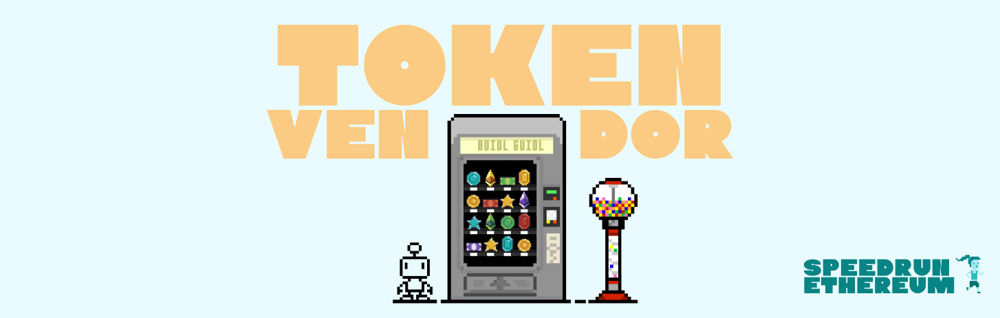

# Token Vendor

An ERC20 token with a vending-machine contract to buy and sell it for ETH.

- **Live demo:** https://token3vendor.vercel.app/
- **Contract (Sepolia):** [0x241e1B8D3Fb3eCD99E3aCF76a33Ed3B256D12742](https://sepolia.etherscan.io/address/0x241e1B8D3Fb3eCD99E3aCF76a33Ed3B256D12742)
- **Stack:** Scaffold-ETH 2, Foundry, Next.js, wagmi/viem

Part of [SpeedRunEthereum](https://speedrunethereum.com).
