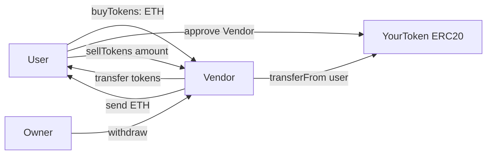

# Token Vendor

An ERC20 token with a vending-machine contract to buy and sell it for ETH.

- **Live demo:** https://token3vendor.vercel.app/
- **Contract (Sepolia):** [0x241e1B8D3Fb3eCD99E3aCF76a33Ed3B256D12742](https://sepolia.etherscan.io/address/0x241e1B8D3Fb3eCD99E3aCF76a33Ed3B256D12742)
- **Stack:** Scaffold-ETH 2, Foundry, Next.js, wagmi/viem

## Tech and flow

- **Solidity + OpenZeppelin** (`ERC20`, `Ownable`): `YourToken` is a fixed-supply token. `Vendor` buys and sells it at 100 tokens per ETH.
- **ERC20 approve pattern**: selling needs `approve` then `transferFrom`.
- **Foundry**: build, test, deploy to Sepolia.
- **Next.js + wagmi/viem + RainbowKit**: buy, approve, sell, and event list.

Part of [SpeedRunEthereum](https://speedrunethereum.com).
